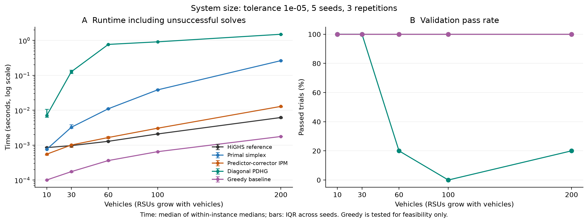

# Linear Programming for Resource Allocation in Vehicular Edge Computing

Course project for **COMP6704: Advanced Topics in Optimization (Fall 2026)**.

This repository contains the model, algorithm implementations, experiment configurations, saved inputs, raw solver outputs, figures, and report for a continuous workload allocation problem in vehicular edge computing. It compares three educational LP implementations with a production solver and a greedy application baseline.

- **Repository:** https://github.com/jzhchu/comp6704-vehicular-edge-lp
- **Report:** [REPORT.md](REPORT.md) (Chinese; includes the formulation, dual, related work, algorithm analysis, experimental results, and references).
- **Formal configuration:** [configs/formal_suite.json](configs/formal_suite.json).
- **Saved validation:** [experiments/formal/audit.json](experiments/formal/audit.json).

## 1. Project scope and course requirements

The project studies a single scheduling window with known vehicle demands, resource requirements, link availability, and roadside unit (RSU) capacities. Workload is divisible across reachable RSUs. The objective combines service cost and a penalty for unserved demand.

The assignment requires multiple algorithm implementations, performance comparisons, reproducible code, and a comprehensive README. The following files support those requirements:

| Course component | Repository evidence |
| --- | --- |
| Background survey and motivation | Sections 1-2 and references in [REPORT.md](REPORT.md) |
| Mathematical problem formulation | Section 3 of the report; `minimal_model.py` |
| Algorithm design and implementation | Section 4 of the report; `algorithms.py` |
| Convergence, solution quality, efficiency, and stability | Formal traces, `runs.csv`, validation results, and generated figures |
| Statistical analysis, ablations, and sensitivity | `analyze_formal.py`, `report_analysis.py`, scaling/budget experiments, and capacity perturbations |
| Code quality and reproducibility | Pinned dependencies, tests, fixed configurations, saved inputs, source snapshots, hashes, and the commands below |
| Repository link in the report | The repository URL is included in the report and in an abstract footnote |

The assignment also asks teams to list all names and student IDs at the start of the report, and gives the guideline that each member independently implement at least one algorithm. Team identity fields remain blank in the report as requested; the team must fill them and accurately describe individual contributions before submission. This repository does not establish who independently implemented each method.

The final Canvas submission is a **single PDF combining the report and slides**, named with the group ID, below 40 MB. The report limit is 15 pages. The GitHub repository supplements that submission; Markdown alone is not the required final submission format.

## 2. Optimization model

For each permitted vehicle-RSU pair `(i, j)`, let `x[i,j] >= 0` be the assigned workload. Let `u[i] >= 0` be the unserved workload of vehicle `i`.

```text
minimize    sum_(i,j in E) c[i,j] * x[i,j] + sum_i p[i] * u[i]
subject to  sum_(j: (i,j) in E) x[i,j] + u[i] = d[i]       for each vehicle i
            sum_(i: (i,j) in E) a[i] * x[i,j] <= C[j]     for each RSU j
            sum_(i: (i,j) in E) b[i] * x[i,j] <= B[j]     for each RSU j
            x[i,j] >= 0, u[i] >= 0
```

`d` is demand, `a` is compute consumption per workload unit, `b` is upload consumption per workload unit, `C` and `B` are capacities, `c` is service cost, and `p` is the unserved-demand penalty. Forbidden links are omitted from the decision variables. Adding capacity slack variables gives `min q^T z` subject to `Az = h, z >= 0`.

The model has no binary assignment decisions, queueing dynamics, variable transmission powers, or task migration costs. Costs are synthetic units and do not directly measure money, energy, or end-to-end latency. Minimizing cost plus a finite penalty is not the same as lexicographically maximizing service.

## 3. Compared methods

| Method / configuration key | Implementation | Role |
| --- | --- | --- |
| Primal simplex / `simplex` | Reduced-cost pricing, ratio tests, deterministic tie handling, Bland fallback after a repeated basis, and fresh LU factorization | Educational LP implementation |
| Predictor-corrector IPM / `ipm` | Infeasible-start primal-dual updates, Mehrotra predictor-corrector directions, and positivity-preserving steps | Educational LP implementation |
| Diagonal PDHG / `pdhg` | Primal-dual matrix-vector updates, nonnegative projection, fixed diagonal steps, and checks of last/ergodic iterates | Educational first-order LP implementation |
| HiGHS / `highs` | SciPy `linprog(method="highs-ds")` | Production dual-simplex reference |
| Capacity-aware greedy / `greedy` | Ordered allocation subject to remaining compute and upload capacities | Feasible application baseline |

The three educational solvers use NumPy/SciPy matrix operations and linear algebra without calling an optimization solver inside their iterations. HiGHS is intentionally an external solver. This PDHG implementation is **not full PDLP**: it does not include the complete restart, adaptive-step, and preprocessing system of PDLP.

## 4. Installation

The recorded formal experiment used **Python 3.12.14**, **NumPy 2.5.4**, and **SciPy 1.18.1** on macOS ARM64. Exact package versions are pinned in [requirements.txt](requirements.txt); platform and thread settings are recorded in [the formal manifest](experiments/formal/manifest.json). Use Python 3.12 or later for these dependencies; only the recorded environment has been validated for the archived run.

The commands below use a POSIX shell on macOS/Linux. Run them from the repository root.

```sh
git clone https://github.com/jzhchu/comp6704-vehicular-edge-lp.git
cd comp6704-vehicular-edge-lp
python3 -m venv .venv
.venv/bin/python -m pip install -r requirements.txt
export LP_PYTHON="$PWD/.venv/bin/python"
export MPLCONFIGDIR="$PWD/.mplconfig"
```

A private repository requires an authenticated GitHub account with access. An existing clone can start at the environment-creation step.

The shell launchers select `LP_PYTHON` first, then the repository's `.venv`, then the original workspace environment if present, and finally `python3`. Setting `LP_PYTHON` explicitly makes the choice unambiguous. Batch launchers restrict common numerical-library thread counts to one.

## 5. Quick start and tests

Run the analytical two-vehicle example into a new local directory:

```sh
./run.sh --instance data/two_vehicles.json --output results_local
.venv/bin/python -m unittest discover -s tests -v
```

The example has two vehicles, each with demand 5, and two RSUs, each with compute/upload capacities 5. Its cost matrix is `[[1, 2], [1.1, 10]]`, with penalty 20 per unserved unit. The optimal allocation sends vehicle 1 to RSU 2 and vehicle 2 to RSU 1, giving cost **15.5**. The specified greedy order gives cost **55**. Both serve all demand.

Outputs include `result.json`, `allocation.csv`, `resources.csv`, and `summary.txt`. The tests cover the analytical optimum, greedy counterexample, resource bottlenecks, disconnected links, invalid inputs, zero demand, scaling, seeded solver comparisons, shadow prices, and formal experiment counts. There are 14 existing tests.

For a short end-to-end check of the formal pipeline:

```sh
./run_formal_suite.sh --smoke --output experiments/formal_smoke_local
.venv/bin/python audit_formal.py --experiment experiments/formal_smoke_local
.venv/bin/python analyze_formal.py --experiment experiments/formal_smoke_local
```

The smoke run reduces the design. Its deliberately small PDHG iteration budgets can produce non-converged runs; those are valid recorded outcomes. An audit pass means the saved records and their labels are internally verified, not that every solver converged.

## 6. Reproduce the formal experiments

### 6.1 Fixed design

The formal configuration uses seeds **11, 23, 37, 53, 71** and normally three timing repetitions. The PDHG budget study uses one repetition per seed.

| Study | Conditions | Timed runs |
| --- | --- | ---: |
| Size | `(N,M) = (10,3), (30,4), (60,6), (100,8), (200,12)` | 375 |
| Capacity | `(30,4)`; compute or upload ratio in `0.4, 0.7, 1.0, 1.3, 1.6`; other ratio fixed at `1.6` | 675 |
| Connectivity | `(60,6)`; radius `0.10, 0.20, 0.35, 0.50` | 300 |
| Target accuracy | `(30,4), (100,8)`; tolerance `1e-3, 1e-5, 1e-7`; four LP methods | 360 |
| Common scaling | `(30,4), (100,8)`; on/off; four LP methods | 240 |
| PDHG budget | `(100,8), (200,12)`; caps `10000, 100000, 1000000` | 30 |
| **Total** | **90 distinct input instances, reused across relevant studies** | **1980** |

The first three studies contain 25, 45, and 20 distinct inputs respectively. The capacity scans share the `(1.6,1.6)` corner, so they have nine distinct settings per seed. The last three studies reuse existing inputs. There are also **90 separate reference solves** and **130 sensitivity solves**, excluded from the 1980 timed comparisons.

Vehicles lie uniformly on a normalized unit road segment, with equally spaced RSUs. A link exists within the selected radius. Demand follows `U(1,5)`, compute consumption `U(0.5,2)`, upload consumption `U(0.2,1)`, RSU cost terms `U(0,1)`, and capacity weights `U(0.5,1.5)`. Service cost is `0.5 + 2*distance + 0.5*RSU_cost_term`, and the unserved penalty is 20. Each resource's total capacity equals its ratio times aggregate resource demand and is divided among RSUs using positive weights. Ratio 1 does not guarantee full service because capacity and connectivity can be mismatched locally. Within a scan, unchanged random inputs are paired across settings.

### 6.2 Run, audit, and analyze

Use a **new output directory** for every run:

```sh
./run_formal_suite.sh --config configs/formal_suite.json --output experiments/formal_rerun
.venv/bin/python audit_formal.py --experiment experiments/formal_rerun
.venv/bin/python analyze_formal.py --experiment experiments/formal_rerun
.venv/bin/python report_analysis.py --experiment experiments/formal_rerun --output experiments/report_analysis_rerun
```

The formal runner refuses a nonempty output directory. Choose another name for a subsequent run. It runs jobs serially in a fixed randomized order, records failures, and saves inputs, source snapshots, configurations, hashes, and environment metadata. Allow several minutes for the full suite; elapsed time depends on hardware and system load.

To verify and regenerate analysis from the **archived data without new solver runs**:

```sh
.venv/bin/python audit_formal.py --experiment experiments/formal
.venv/bin/python analyze_formal.py --experiment experiments/formal
.venv/bin/python report_analysis.py --experiment experiments/formal --output experiments/report_analysis_rebuilt
```

The audit verifies source/input/result hashes and recomputes constraints, certificates, reference gaps, sensitivity predictions, and pass labels from saved vectors. The analysis command regenerates summary tables and six PNG/SVG figure pairs inside the selected experiment directory. `report_analysis.py` adds cost decomposition, paired monotonicity checks, representative convergence curves, and paper statistics. It verifies its source data and adds no solver runs.

### 6.3 Acceptance and timing

An LP run must report `converged`, satisfy the common certificate and business feasibility thresholds in original model units, and have relative reference objective gap at most `5*tolerance`. The certificate combines normalized primal residual, dual feasibility violation, duality gap, nonnegativity violation, and row-wise residual. Greedy is evaluated for business feasibility only; its pass count is not an LP optimality result.

The default tolerance is `1e-5`. Default iteration caps are 10000 for simplex, 150 for IPM, and 100000 for PDHG. Soft time limits are 8 seconds normally and 12 seconds for the budget study. Checks occur at algorithm checkpoints, so a soft limit is not a strict wall-clock cutoff. HiGHS internal feasibility tolerances remain fixed at `1e-9` during the target-accuracy study.

Recorded solver times include internal setup and monitoring, but exclude shared input generation, common model construction, reference solves, and output-file writing. Failed runs remain in time summaries. Repetitions are summarized by median for each input, then summarized across seeds. Bootstrap resampling uses seeds as clusters; three timing repetitions are not three independent random scenarios. With five seeds, intervals are descriptive.

Turning common scaling off removes the shared row/column/objective transformation. It retains PDHG's diagonal steps and HiGHS preprocessing. Iteration counts across different algorithm families are not equal-cost operations.

## 7. Archived results and figure map

The saved formal audit reports:

| Method | Passed / timed runs | Meaning |
| --- | ---: | --- |
| HiGHS | 420 / 420 | Common LP acceptance passed |
| Primal simplex | 420 / 420 | Common LP acceptance passed |
| Predictor-corrector IPM | 420 / 420 | Common LP acceptance passed |
| Diagonal PDHG | 310 / 450 | 139 iteration-limit runs and 1 time-limit run retained |
| Greedy | 270 / 270 | Business feasibility only |

Across the 90 main input instances, mean service fractions were **87.93%** for reference LP allocation and **75.81%** for greedy. The mean per-instance greedy cost gap relative to the optimum was **127.34%**. These statistics have different definitions: demand-normalized cost components and mean relative objective gaps must not be interchanged. See the report and `experiments/report_analysis/paper_statistics.json` for details.

| Report evidence | Files |
| --- | --- |
| Scaling of runtime and pass rate | `experiments/formal/figures/01_scale.{png,svg}` |
| Capacity and connectivity | `experiments/formal/figures/02_resources_connectivity.{png,svg}` |
| Target accuracy | `experiments/formal/figures/03_precision.{png,svg}` |
| Common-scaling ablation | `experiments/formal/figures/04_scaling_ablation.{png,svg}` |
| PDHG iteration budget | `experiments/formal/figures/05_pdhg_budget.{png,svg}` |
| Dual sensitivity | `experiments/formal/figures/06_dual_sensitivity.{png,svg}` |
| Cost components and service | `experiments/report_analysis/resource_service.{png,svg}` |
| Representative convergence | `experiments/report_analysis/convergence.{png,svg}` |



`runs.csv` contains individual timed observations; `aggregate.csv` summarizes repetitions; `cell_summary.csv` summarizes across seeds; `statistics.json` contains statistical summaries. `traces/` stores histories and raw primal/dual vectors. `references/` stores certified reference solutions. `sensitivity/` and `sensitivity.csv` retain baseline and perturbed-capacity solutions.

Exact historical implementation files are preserved under each batch's `source_snapshot/`. Their hashes must remain unchanged. To run a snapshot, create an environment from its requirements and invoke its runner with an explicit new output path. Regenerating input/solution statistics is supported; bit-for-bit times and all time-limit outcomes are not guaranteed across machines.

## 8. Earlier experiments

`experiments/batch/` preserves the earlier 28-input, 420-run benchmark, and `experiments/pilot/` preserves pilot data. They are separate from the formal suite and must not be pooled with it. To rerun the earlier benchmark and regenerate its figures:

```sh
./run_experiments.sh --config configs/benchmark.json --output experiments/batch_rerun
.venv/bin/python audit_results.py --experiment experiments/batch_rerun
.venv/bin/python plot_results.py --experiment experiments/batch_rerun
```

Unlike the formal runner, the earlier runner can overwrite files in an existing directory. Always use a new path. `--pilot` selects a smaller run.

## 9. Repository layout

```text
.
├── README.md                    English reproduction guide
├── REPORT.md                    Complete project report (Chinese)
├── requirements.txt             Exact package versions
├── minimal_model.py             Input checks, model, reference, greedy, outputs
├── algorithms.py                Shared standard form and three educational solvers
├── generate_instances.py        Seeded, paired synthetic input generation
├── formal_suite.py              Formal runner and capacity sensitivity solves
├── audit_formal.py              Independent verification of saved formal records
├── analyze_formal.py            Statistics, summaries, six figure pairs
├── report_analysis.py           Additional paper statistics and figures
├── benchmark.py                 Earlier benchmark runner
├── audit_results.py             Earlier benchmark verification
├── plot_results.py              Earlier benchmark figures
├── run.sh                       Analytical/custom example launcher
├── run_formal_suite.sh           Formal launcher with thread limits
├── run_experiments.sh            Earlier benchmark launcher with thread limits
├── configs/                     Fixed formal and earlier benchmark designs
├── data/two_vehicles.json        Analytical example input
├── tests/                       Existing unit and solver checks
├── results/                     Archived analytical example outputs
└── experiments/
    ├── formal/                  Canonical formal inputs, traces, figures, snapshots
    ├── report_analysis/         Additional evidence used in the report
    ├── batch/                   Earlier benchmark and source snapshot
    └── pilot/                   Earlier pilot outputs
```

The repository includes raw experiment traces, which account for most of its size. Local environments, caches, and newly named rerun directories are excluded from version control.

## 10. Custom inputs

Use the schema in `data/two_vehicles.json`:

- `demand`, `compute_per_workload`, `upload_per_workload`, and `unserved_penalty`: one entry per vehicle.
- `compute_capacity` and `upload_capacity`: one entry per RSU.
- `cost`: an `N` by `M` matrix; JSON `null` means the link is forbidden.
- Demand, capacities, costs, and penalties must be nonnegative; per-workload resource coefficients must be positive.

```sh
./run.sh --instance data/my_instance.json --output results_custom
```

Keep changes to synthetic experiment settings in a separate configuration file and pass it with `--config`. Do not silently replace the archived formal configuration or its source snapshot.

## 11. Interpretation and limitations

These results describe this synthetic generator, divisible workload model, and specific implementations. There are no real vehicle traces, protocol simulations, end-to-end latency measurements, memory measurements, or industrial-scale tests. The size study increases both vehicle and RSU counts, so it does not isolate either dimension alone.

The educational solvers contain monitoring overhead and simpler linear algebra than a production solver. Runtime differences cannot be attributed solely to algorithm theory. A PDHG iteration-limit outcome does not imply an infeasible model or a general failure of first-order methods. Objectives from runs that fail common checks must not be presented as certified optima.

## 12. References and implementation context

Full bibliographic information and the relationship to this project appear in the report. Key sources include:

- [Boyd and Vandenberghe, Convex Optimization](https://web.stanford.edu/~boyd/cvxbook/) - optimization and duality background.
- [Bland (1977)](https://doi.org/10.1287/moor.2.2.103) - anti-cycling pivot rules.
- [Mehrotra (1992)](https://doi.org/10.1137/0802028) - predictor-corrector IPM.
- [Chambolle and Pock (2011)](https://doi.org/10.1007/s10851-010-0251-1) - primal-dual first-order methods.
- [Applegate et al. (2021)](https://arxiv.org/abs/2106.04756) - practical LP methods based on PDHG/PDLP.
- [SciPy HiGHS dual-simplex interface](https://docs.scipy.org/doc/scipy/reference/optimize.linprog-highs-ds.html) - reference solver interface.

This is a course research artifact. Algorithm ownership and contribution statements should reflect the team's actual work and cited sources.
