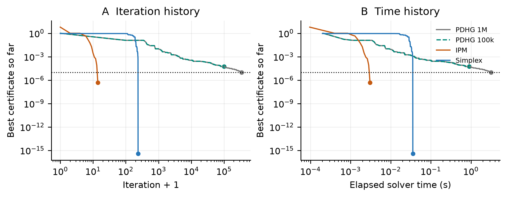
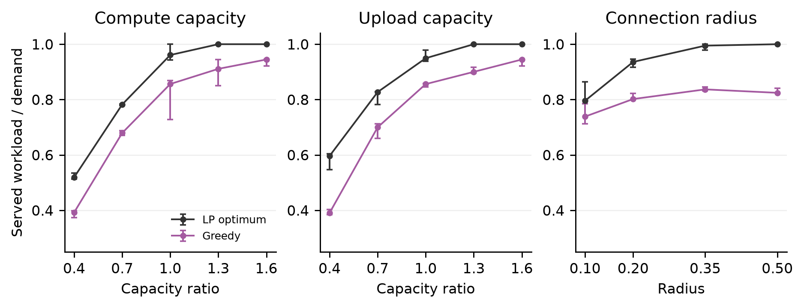

# 车联网边缘计算资源分配的线性规划建模与算法比较

Linear Programming for Resource Allocation in Vehicular Edge Computing

**课程：** COMP6704 Advanced Topics in Optimization

**组号：**

**组员姓名与学号：**

**GitHub 代码仓库：** https://github.com/jzhchu/comp6704-vehicular-edge-lp

## 摘要

本文研究单个调度窗口内车辆向路侧单元分配可拆分计算负载的问题。模型以服务成本与未满足需求惩罚之和为目标，同时约束车辆需求、计算容量、上传容量和连接关系。本文实现原始单纯形法、原始对偶预测校正内点法和固定对角步长的原始对偶混合梯度法（PDHG），并与 HiGHS 双单纯形求解器和容量约束贪心基线比较。正式实验包含 90 个不同合成输入、1,980 次计时算法运行及 130 次资源敏感性求解。单纯形法、内点法和 HiGHS 在全部对应比较中各通过 420/420 次验证；PDHG 通过 310/450 次，其余达到迭代或时间上限。在主实验中，LP 的平均服务率为 87.93%，贪心为 75.81%；逐实例计算的贪心相对最优成本差距平均为 127.34%，改善主要来自减少未满足需求惩罚。精度、预算与缩放实验表明，当前 PDHG 实现的实际表现取决于精度要求、尺度变换和计算预算。小幅容量扰动的重新求解结果支持对偶价格的局部解释。上述结论适用于当前合成分布、固定单窗口模型和具体实现。代码与复现实验材料见项目仓库。[^code]

**关键词：** 线性规划；车联网；边缘计算；资源分配；单纯形法；内点法；PDHG

## 1 引言

路侧单元（Roadside Unit，RSU）可以为附近车辆提供边缘计算服务。当多辆车竞争同一台 RSU 的计算与通信资源时，逐车选择成本最低的服务器可能提前消耗稀缺容量，使后续车辆无法处理工作量。允许车辆在多个可连接 RSU 之间分配负载后，资源选择需要考虑车辆之间的相互影响。

本文研究一个参数已知的调度窗口。车辆需求、单位计算量、上传数据量、路径成本和 RSU 容量均作为输入。通过允许工作量连续拆分，并固定单位资源消耗和成本，可将该问题表示为线性规划（Linear Programming，LP）。模型不包含服务器选择的整数决策、可变传输功率、队列时延或跨窗口迁移，因此研究对象是容量约束下的连续负载分配。

研究回答以下问题：

1. 全局 LP 分配相较指定的局部贪心规则，能改善多少目标值，其改善来自服务成本还是未满足惩罚？
2. 不同 LP 方法达到相同原始单位精度时，解质量、运行时间与通过率如何变化？
3. 容量、连接范围、求解精度、共同缩放与计算预算如何影响结果？对偶变量能否解释增加资源的局部收益？

本文的工作包括连续 LP 建模与对偶推导、三类算法的教学实现、独立解验证，以及固定种子的配对实验。算法比较同时记录成功与未达标结果。研究重点是模型、实现和实验解释，不提出新的通用 LP 算法。

## 2 相关工作

### 2.1 车联网中的联合资源分配

[Dai 等（2018）](https://arxiv.org/abs/1807.08718)研究了车联网边缘计算中的联合卸载与资源分配，将通信和计算共同纳入任务处理分析，并优化系统效用。该工作说明，多车辆集中选择有限服务器时，独立卸载决策可能造成资源竞争。本文采用独立构建的连续容量模型，不复现其 JOSC 算法，也不把其包含时延与卸载选择的完整问题直接视为本文的 LP。

这一取舍限定了结论范围：本文可以比较不同方法如何分配给定资源预算，但不能用目标值改善直接推断真实任务时延、能耗或道路安全性能。合成工作量可代表可分批数据处理或独立小任务的聚合需求；不可拆分任务需要额外的整数变量或其他建模方式。

### 2.2 线性规划求解方法

LP 的对偶理论为最优性检查和资源边际价值提供基础，相关标准理论可参见 [Boyd 与 Vandenberghe（2004）](https://web.stanford.edu/~boyd/cvxbook/)。本文不仅比较原始目标值，还检查原始与对偶可行性及其目标差距。

单纯形法通过基变换搜索最优解。退化情况下，枢轴规则会影响算法行为；[Bland（1977）](https://doi.org/10.1287/moor.2.2.103)给出了保证有限性的枢轴规则。本文使用最负约化成本选入基，在检测到重复基后切换为 Bland 规则，并使用确定性的比值平局处理。成熟修正单纯形还包含稀疏分解更新等技术；[Huangfu 与 Hall（2018）](https://doi.org/10.1007/s12532-017-0130-5)展示了稀疏线性代数和算法实现对性能的重要影响，因此本文不会将教学实现与成熟求解器的时间差完全归因于算法类别。

[Mehrotra（1992）](https://doi.org/10.1137/0802028)研究了预测校正原始对偶内点法及其实用实现。本文采用不可行起点、仿射预测方向、中心参数估计和二阶校正项，比较其在同一组 LP 上达到共同误差标准的表现。

### 2.3 一阶原始对偶方法与比较范围

[Chambolle 与 Pock（2011）](https://doi.org/10.1007/s10851-010-0251-1)研究了具有鞍点结构的凸问题的一阶原始对偶算法。[Applegate 等（2021）](https://arxiv.org/abs/2106.04756)将 PDHG 应用于 LP，并结合预处理、对角预条件、自适应步长与重启等技术形成 PDLP。本文仅实现固定对角步长、非负投影和遍历平均，不包含完整的 PDLP 机制，不能将本实验中的 PDHG 结果作为完整 PDLP 的性能结论。

[OR-Tools 的 LP 技术说明](https://developers.google.com/optimization/lp/lp_advanced)讨论了单纯形、内点与一阶方法在精度和数值表现上的差异，也强调求解器状态需要结合误差容限理解。本文据此采用共同的原始单位验证标准，并保留超时、迭代上限和未通过证书的结果。HiGHS 通过 [SciPy 的 `highs-ds` 接口](https://docs.scipy.org/doc/scipy/reference/optimize.linprog-highs-ds.html)调用，用作成熟实现的参考。

## 3 系统模型与问题定义

### 3.1 场景与变量

设车辆集合为 $V$，RSU 集合为 $R$，其规模分别为 $N$ 和 $M$。允许连接集合 $E\subseteq V\times R$ 在调度窗口内固定。仅对 $(i,j)\in E$ 建立分配变量，禁止连接不使用大惩罚成本近似处理。

**表 3.1 主要符号**

| 符号 | 含义 | 单位 |
| --- | --- | --- |
| $d_i$ | 车辆需求 | 工作量单位 WU |
| $a_i$ | 单位工作量的计算资源消耗 | 计算资源单位/WU |
| $b_i$ | 单位工作量的上传数据量 | 数据资源单位/WU |
| $C_j$ | RSU 的窗口内计算容量 | 计算资源单位 |
| $B_j$ | RSU 的窗口内上传容量 | 数据资源单位 |
| $c_{ij}$ | 路径单位服务成本 | 成本单位/WU |
| $p_i$ | 单位未满足需求惩罚 | 成本单位/WU |
| $x_{ij}\geq0$ | 分配至 RSU 的工作量 | WU |
| $u_i\geq0$ | 窗口内未满足需求 | WU |

需求、容量、成本与惩罚非负，单位资源消耗为正。成本为统一的合成成本单位，不直接代表货币支出或端到端时延。工作量允许拆分，拆分、合并及迁移开销不计入当前模型。

### 3.2 原始线性规划

目标函数为实际服务成本与未满足需求惩罚之和：

$$
\begin{aligned}
\min_{x,u}\quad
F(x,u)&=\sum_{(i,j)\in E}c_{ij}x_{ij}+\sum_{i\in V}p_i u_i,\\
\text{s.t.}\quad
\sum_{j:(i,j)\in E}x_{ij}+u_i&=d_i, &&i\in V,\\
\sum_{i:(i,j)\in E}a_i x_{ij}&\leq C_j, &&j\in R,\\
\sum_{i:(i,j)\in E}b_i x_{ij}&\leq B_j, &&j\in R,\\
x_{ij}&\geq0, &&(i,j)\in E,\\
u_i&\geq0, &&i\in V.
\end{aligned}
$$

需求等式防止重复服务，两个容量约束分别限制计算资源与上传数据预算。未满足变量使零容量或断连输入仍然可行：取全部分配为零、未满足量等于需求即可。由于分配与未满足量均受需求上界约束，且目标非负，本问题存在有限最优值。有限惩罚表达的是成本权衡，并不等价于先最大化服务率再最小化服务成本。

添加计算与上传松弛变量后，问题可写成标准形式：

$$
\min_{z\geq0}q^{\mathsf T}z
\quad\text{s.t.}\quad Az=h.
$$

其中 $z$ 按允许边分配量、未满足量和两类容量松弛排列，约束数 $m=N+2M$，变量数 $n=|E|+N+2M$。当前非零资源系数下，$A$ 的非零元素数为 $3|E|+N+2M$。未满足量与松弛列构成单位基，可直接提供单纯形法的初始可行基。

### 3.3 对偶与资源价格

对需求等式引入自由变量 $\pi_i$，对计算与上传容量引入非负变量 $\lambda_j$ 和 $\mu_j$。对应对偶问题为：

$$
\begin{aligned}
\max_{\pi,\lambda,\mu}\quad
&\sum_i d_i\pi_i-\sum_j C_j\lambda_j-\sum_j B_j\mu_j,\\
\text{s.t.}\quad
&\pi_i\leq c_{ij}+a_i\lambda_j+b_i\mu_j,
&& (i,j)\in E,\\
&\pi_i\leq p_i, && i\in V,\\
&\lambda_j,\mu_j\geq0,\quad \pi_i\in\mathbb R.
\end{aligned}
$$

该形式可由拉格朗日函数中 $x_{ij}$ 与 $u_i$ 的系数非负条件得到。原始问题可行且最优值有限，LP 强对偶性使最优原始与对偶目标一致。

在相同对偶价格仍适用的局部范围内，增加计算容量 $\Delta C_j$ 的目标变化由 $-\lambda_j\Delta C_j$ 预测，上传资源同理。正价格表示资源具有边际价值；容量约束恰好取等号并不保证其价格为正。价格可能不唯一，较大扰动也可能改变有效约束，故本文通过有限扰动和重新求解验证局部预测。

### 3.4 可解析的检查实例

取两辆车和两个 RSU，需求均为 5，单位计算量和上传量均为 1，每台 RSU 的两类容量均为 5，惩罚均为 20，允许全部连接。

| 车辆 | RSU 1 单位成本 | RSU 2 单位成本 |
| --- | ---: | ---: |
| 1 | 1 | 2 |
| 2 | 1.1 | 10 |

最优分配为车辆 1 向 RSU 2 分配 5、车辆 2 向 RSU 1 分配 5，目标为 15.5。对偶取 $\pi=(2,2.1)$、$\lambda=(1,0)$、$\mu=(0,0)$，满足全部对偶约束，且对偶目标同为 15.5，因此该分配达到最优。按车辆编号处理、优先选择最低成本 RSU 的贪心则得到成本 55。该实例检验变量顺序、容量约束和全局资源竞争，不用于统计性能结论。

## 4 算法设计与实现

### 4.1 共同标准形式与缩放

三种自编算法共用相同的标准形式。令 $D$ 为正对角列尺度矩阵：分配变量与未满足变量使用对应车辆需求，松弛变量使用对应容量，各尺度下限为 1。行尺度与目标尺度为：

$$
L_{\ell\ell}=\frac{1}{\max(1,|h_\ell|)},
\qquad \gamma=\max(1,\|Dq\|_\infty).
$$

求解器接收：

$$
\widetilde A=LAD,\quad
\widetilde h=Lh,\quad
\widetilde q=Dq/\gamma,\quad
\widetilde z=D^{-1}z.
$$

若 $\widetilde y$ 为缩放形式的标准对偶变量，则逆变换为 $z=D\widetilde z$、$y=\gamma L\widetilde y$。后续算法公式用 $A,h,q$ 表示送入求解器的对应矩阵；全部质量检查均在逆变换回原始单位后执行。缩放消融把上述三个尺度均设为单位尺度。

### 4.2 原始单纯形法

算法从全部需求未满足的可行基开始。对当前基矩阵 $A_{\mathcal B}$，通过 LU 分解求解：

$$
A_{\mathcal B}z_{\mathcal B}=h,\qquad
A_{\mathcal B}^{\mathsf T}y=q_{\mathcal B},\qquad
\bar q=q-A^{\mathsf T}y.
$$

有负约化成本时，通常选择最负者入基；求解 $A_{\mathcal B}w=A_k$ 后，对 $w_r>0$ 的行进行最小比值检验。离基平局按基变量编号处理；检测到重复基后，入基变量也采用 Bland 的最小编号规则。实现不显式计算基矩阵逆，每次迭代重新分解当前基，而未实现稀疏分解更新。

算法优先检查共同误差证书，再检查预算与可用枢轴。负基变量超出容差、无可用方向及数值求解异常分别记录为未达标状态。该教学实现不据实测迭代次数宣称一般 LP 的多项式迭代保证。

### 4.3 原始对偶预测校正内点法

标准形式的对偶松弛 $s$ 满足以下最优性条件：

$$
Az=h,\quad A^{\mathsf T}y+s=q,\quad
z,s\geq0,\quad z\circ s=0.
$$

初始化为 $z=s=\mathbf1$、$y=0$，允许原始和对偶等式暂不满足。令 $r_p=h-Az$、$r_d=q-A^{\mathsf T}y-s$、$Z=\operatorname{diag}(z)$、$S=\operatorname{diag}(s)$。Newton 方向满足：

$$
\begin{bmatrix}
A&0&0\\
0&A^{\mathsf T}&I\\
S&0&Z
\end{bmatrix}
\begin{bmatrix}\Delta z\\\Delta y\\\Delta s\end{bmatrix}
=
\begin{bmatrix}r_p\\r_d\\r_c\end{bmatrix}.
$$

仿射预测使用 $r_c=-z\circ s$。定义平均互补量 $\nu=z^{\mathsf T}s/n$，根据仿射方向估计 $\nu_{\mathrm{aff}}$，将中心系数 $(\nu_{\mathrm{aff}}/\nu)^3$ 截断至 $[0,1]$。校正方向使用：

$$
r_c=\sigma\nu\mathbf1-z\circ s
-\Delta z_{\mathrm{aff}}\circ\Delta s_{\mathrm{aff}}.
$$

实现消去部分变量，对 Schur 矩阵 $A\operatorname{diag}(z/s)A^{\mathsf T}$ 进行 Cholesky 分解，预测和校正共享该次分解。数值分解失败时逐步增加对角正则项。正性允许步长先截断为 1，再乘以 0.995；原始与对偶步长分别确定。该实现采用实用预测校正策略，本文不将其预算、正则化和启发式停止过程直接等同于某个理论内点算法的完整复杂度保证。

### 4.4 固定对角步长 PDHG

将标准形式写成鞍点问题：

$$
\min_{z\geq0}\max_v\quad q^{\mathsf T}z+v^{\mathsf T}(Az-h).
$$

初始化采用全部未满足的可行原始点和 $v=0$。定义对角原始步长 $T$ 与对偶步长 $\Sigma$：

$$
T_{kk}=\frac{0.9}{\max(10^{-12},\sum_\ell|A_{\ell k}|)},\qquad
\Sigma_{\ell\ell}=\frac{0.9}{\max(10^{-12},\sum_k|A_{\ell k}|)}.
$$

每次迭代执行：

$$
\begin{aligned}
v^{t+1}&=v^t+\Sigma(A\bar z^t-h),\\
z^{t+1}&=\max\{z^t-T(q+A^{\mathsf T}v^{t+1}),0\},\\
\bar z^{t+1}&=2z^{t+1}-z^t.
\end{aligned}
$$

标准对偶变量为 $y=-v$。算法同时维护迭代的算术平均，每 50 次迭代或达到迭代上限时，比较当前解与平均解的原始单位证书，保留迄今证书最小者。最终返回该解，故返回证书不一定等于末次原始迭代的证书。

这组固定对角步长满足 $\|\Sigma^{1/2}AT^{1/2}\|_2\leq0.9<1$ 的安全范数条件。标准 PDHG 在适当凸鞍点与步长条件下具有有界测试集上的遍历差距 $O(1/t)$ 结果，见 [Chambolle 与 Pock（2011）](https://doi.org/10.1007/s10851-010-0251-1)。该结论不能直接替代本报告证书分数的下降率，也不保证某个固定迭代上限足以达到目标阈值。

### 4.5 贪心与 HiGHS 参考

贪心按 $p_i$ 降序处理车辆，惩罚相同时按车辆编号处理。对每辆车，按单位成本从低到高遍历可用 RSU。只在 $c_{ij}<p_i$ 时分配，增量为剩余需求、剩余计算容量除以 $a_i$、剩余上传容量除以 $b_i$ 三者的最小值。已分配资源不回退重排。因此它保证容量内的可行分配，但不保证最优。

HiGHS 使用 `linprog(method="highs-ds")` 求解同一标准形式，保留预处理，原始和对偶内部可行性阈值均设为 $10^{-9}$。每个不同输入先进行一次计时外参考求解，再分别计时比较各方法。参考目标不用于自编算法更新或初始化。HiGHS 的计时方法和参考调用使用同一求解器，故它们不是两个独立算法。

### 4.6 每步计算开销

下表描述当前矩阵实现的主要运算，不把它作为全部运行时间的精确模型。令 $s_A=\operatorname{nnz}(A)$，不计保存迭代历史的额外空间。

| 方法 | 主要每步运算 | 核心空间量级 |
| --- | --- | --- |
| 单纯形 | 稠密基分解与约化成本，约 $O(m^3+mn)$ | $O(mn+m^2)$ |
| 内点法 | Schur 组装与分解，约 $O(m^2n+m^3)$ | $O(mn+m^2)$ |
| PDHG | 稀疏矩阵向量乘与逐元素更新，约 $O(s_A+m+n)$ | $O(s_A+m+n)$ |
| 贪心 | 对车辆和候选边排序后单次分配 | 随候选边与输入存储增长 |

内点法和单纯形的单步开销较高，但可能以较少迭代达到严格精度；PDHG 的单步开销较低，但可能需要更多迭代。实际排序还取决于稀疏性、分解更新、预处理和监控开销，因此本文同时报告耗时、精度与通过率。

## 5 数据生成与实验设置

### 5.1 固定种子的合成输入

车辆需求、单位计算量、单位上传量分别独立采样自 $U(1,5)$、$U(0.5,2)$、$U(0.2,1)$。车辆位置均匀分布于单位路段，RSU 等距布置；当距离 $\delta_{ij}$ 不大于半径 $r$ 时建立连接。令 RSU 随机成本项 $\xi_j\sim U(0,1)$，允许边成本为：

$$
c_{ij}=0.5+2\delta_{ij}+0.5\xi_j,\qquad p_i=20.
$$

分别采样正权重 $w_j^{C},w_j^{B}\sim U(0.5,1.5)$，生成容量：

$$
C_j=\rho_C\Bigl(\sum_i a_i d_i\Bigr)\frac{w_j^C}{\sum_k w_k^C},\qquad
B_j=\rho_B\Bigl(\sum_i b_i d_i\Bigr)\frac{w_j^B}{\sum_k w_k^B}.
$$

因此 $\rho_C$ 和 $\rho_B$ 分别为该类总容量与总需求之比。相同种子、相同车辆与 RSU 数下，容量和半径扫描保持其他随机输入一致。规模实验同时增加车辆与 RSU 数，不单独识别某一个规模维度的影响。

### 5.2 实验矩阵与预算

**表 5.1 正式实验配置与计时求解数量**

| 实验 | 变化条件 | 计时次数 |
| --- | --- | ---: |
| 规模 | 车辆/RSU 为 10/3、30/4、60/6、100/8、200/12 | 375 |
| 容量 | 30/4；计算或上传比例为 0.4、0.7、1.0、1.3、1.6；另一类为 1.6 | 675 |
| 连接范围 | 60/6；半径为 0.10、0.20、0.35、0.50 | 300 |
| 目标精度 | 30/4 与 100/8；阈值为 $10^{-3}$、$10^{-5}$、$10^{-7}$；四种 LP 方法 | 360 |
| 共同缩放 | 30/4 与 100/8；共同列、行与目标缩放开关；四种 LP 方法 | 240 |
| PDHG 预算 | 100/8 与 200/12；迭代上限为 10,000、100,000、1,000,000 | 30 |

前 3 项为主实验，包含 90 个不同输入与 1,350 次计时求解；重复容量角点只运行一次。所有配置使用种子 11、23、37、53、71，一般配置每种方法重复 3 次，预算实验每种子运行 1 次，总计 1,980 次。精度、缩放和预算实验复用主实验中的部分输入。

默认计算与上传容量比例均为 1，连接半径为 0.25，目标阈值为 $10^{-5}$。单纯形、内点法、PDHG 的默认迭代上限分别为 10,000、150、100,000。一般软时限为 8 秒，PDHG 预算实验为 12 秒；检查与迭代边界可能使实际停止时间略超时。另有 90 次计时外参考求解和 130 次敏感性求解，均不混入算法耗时比较。

### 5.3 原始单位评价与成功标准

对逆缩放后的标准形式变量，定义：

$$
\begin{aligned}
r_p&=\frac{\|Az-h\|_\infty}{1+\|h\|_\infty},\qquad
r_{\mathrm{row}}=\max_\ell\frac{|(Az-h)_\ell|}{1+|h_\ell|},\\
r_d&=\frac{\|(A^{\mathsf T}y-q)_+\|_\infty}{1+\|q\|_\infty},\qquad
r_n=\frac{\|(-z)_+\|_\infty}{1+\|z\|_\infty},\\
g&=\frac{|q^{\mathsf T}z-h^{\mathsf T}y|}
{1+|q^{\mathsf T}z|+|h^{\mathsf T}y|},\qquad
\mathcal R=\max\{r_p,r_{\mathrm{row}},r_d,r_n,g\}.
\end{aligned}
$$

其中 $(\cdot)_+$ 表示逐元素取正部。逐行检查防止较大的容量右端项掩盖较小需求等式的违反量。另由分配矩阵独立重算业务可行性：需求等式误差按 $1+d_i$ 归一化，两类容量越界分别按 $1+C_j$ 与 $1+B_j$ 归一化，同时检查分配和未满足量的绝对负值、禁止边的绝对分配量；以上最大值记为 $\mathcal V$。

相对参考目标差距与服务率定义为：

$$
g_{\mathrm{ref}}=\frac{|F-F_{\mathrm{ref}}|}{\max(1,|F_{\mathrm{ref}}|)},
\qquad \eta=\frac{\sum_{(i,j)\in E}x_{ij}}{\sum_i d_i}.
$$

对本实验总需求为正的输入，LP 方法只有在返回收敛状态、$\mathcal R\leq\varepsilon$、$\mathcal V\leq\varepsilon$ 且 $g_{\mathrm{ref}}\leq5\varepsilon$ 时才记为通过。计时外参考解的证书与业务可行性阈值为 $10^{-8}$。贪心仅要求 $\mathcal V\leq\varepsilon$，其通过率不代表求得最优解。每次运行也保留原始绝对业务误差。

### 5.4 环境 计时与统计

实验记录环境为 macOS 27.0.1 arm64、Python 3.12.14、NumPy 2.5.4 和 SciPy 1.18.1。数值计算线程环境变量设为 1，先预热，再按固定种子生成的随机顺序串行运行。计时包括方法内部准备和误差监控，不包括实例生成、公共建模、参考求解、写盘和后续复核。

耗时先对每个输入的重复取中位数，再跨五个种子报告中位数与四分位区间。未达标运行不删除，其时间也参与对应汇总。贪心收益分析对 90 个不同主实验输入等权统计；相对成本差距先逐实例取比值再平均。成本分解则先除以各实例总需求再平均，两者的分母与聚合顺序不同。

不确定性分析以随机种子为簇，使用种子 6704 进行 10,000 次 bootstrap 重抽样。同一种子的不同配置共同重抽，计时重复不当作独立工作负载。只有五个种子簇，百分位区间用作描述性统计。

### 5.5 实现检查与数据保留

代码检查覆盖解析最优解、零容量、上传瓶颈、断连、零需求、非法输入、独立验证器、随机实例参考比较、缩放等价性与已知影子价格等情况，共 14 项测试。正式输出保存每个输入、运行配置、原始与对偶变量、分配、停止状态及误差历史。独立复核重新检查全部计时与参考记录，并校验输入和源码快照哈希。后续统计只读取保存结果，不把未达标记录改标为成功。

## 6 实验结果与分析

### 6.1 解质量与贪心基线

表 6.1 给出统一精度下的主实验结果。三种自编 LP 方法均使用相同标准形式和原始单位验证。HiGHS 计时结果与计时外参考调用分别记录；两者采用同一成熟求解器，参考值不参与自编算法初始化。

**表 6.1 主实验的解验证结果**

| 方法 | 通过次数 | 判定范围 | 通过解的最大相对参考差距 |
| --- | --- | --- | --- |
| HiGHS | 270/270 | 可行性与最优性 | 0 |
| 单纯形 | 270/270 | 可行性与最优性 | 6.45e-09 |
| 内点法 | 270/270 | 可行性与最优性 | 1.49e-05 |
| PDHG | 201/270 | 可行性与最优性 | 2.12e-05 |
| 贪心 | 270/270 | 仅业务可行性 | 不提供最优性证书 |

PDHG 的主实验通过率为 74.44%，69 次未达标运行均触发迭代上限。计入精度、缩放和预算实验后，单纯形、内点法及 HiGHS 各通过 420/420 次；PDHG 通过 310/450 次，其余为 139 次迭代上限和 1 次超时。附加实验条件不同，因此后文按条件分析，不将混合通过率视为单一场景的性能指标。

为解释贪心与 LP 的目标差异，将总目标拆分为实际服务成本与未满足需求惩罚。各实例的成本先除以该实例总需求，再对 90 个输入等权平均；服务率为已服务工作量除以总需求。重复运行不重复计入该统计。

$$
F=F_{\mathrm{service}}+F_{\mathrm{unserved}}.
$$

**表 6.2 成本分解与平均服务率**

| 方法 | 服务成本每 WU | 惩罚每 WU | 总目标每 WU | 服务率 |
| --- | --- | --- | --- | --- |
| LP 参考解 | 0.8057 | 2.4146 | 3.2203 | 87.93% |
| 贪心 | 0.6890 | 4.8389 | 5.5279 | 75.81% |

LP 的平均服务率比贪心高 12.12 个百分点。相应地，LP 每单位总需求的服务成本增加 0.1168，未满足惩罚减少 2.4243，总目标减少 2.3076。这表明当前收益主要来自更充分地利用受限资源，减少未处理工作量；不能将该结果解释为 LP 降低了单位已服务负载的处理价格。

逐实例计算贪心相对参考目标的差距后，其平均值为 127.34%，中位数为 93.94%。该计算先取比值再平均，与表 6.2 的两组平均目标之比不同。按随机种子成簇进行 10,000 次 bootstrap 重抽样，平均差距的百分位 95% 区间为 114.91% 至 142.14%。同一种子的不同配置共同重抽，三个计时重复不视为独立样本。只有 5 个种子簇，该区间仅描述本批数据的波动。

上述结果依赖惩罚系数 20、车辆处理顺序和当前成本分布。实验支持该贪心规则在本模型中存在全局资源竞争损失，不支持将相同收益幅度推广到其他惩罚设置或其他启发式方法。

### 6.2 规模变化与代表性收敛过程

表 6.3 的时间先对同一输入的 3 次重复取中位数，再取 5 个种子中位数，包含未达标运行。HiGHS 与内点法在测试规模下均具有较低耗时；贪心耗时更低，但解质量已在上一节单独评价。

**表 6.3 规模实验的中位耗时与 PDHG 通过次数 耗时单位为毫秒**

| 车辆/RSU | HiGHS | 单纯形 | 内点法 | PDHG | PDHG 通过 |
| --- | --- | --- | --- | --- | --- |
| 10/3 | 0.85 | 0.76 | 0.55 | 7.06 | 15/15 |
| 30/4 | 0.97 | 3.26 | 1.01 | 126.99 | 15/15 |
| 60/6 | 1.29 | 11.03 | 1.65 | 768.59 | 3/15 |
| 100/8 | 2.09 | 38.30 | 3.05 | 910.47 | 0/15 |
| 200/12 | 6.18 | 263.17 | 12.88 | 1498.88 | 3/15 |

从 10/3 扩展至 200/12 时，单纯形法的中位耗时由 0.76 毫秒增加至 263.17 毫秒，内点法由 0.55 增加至 12.88 毫秒。单纯形实现每次重新进行稠密基矩阵分解，内点法也使用稠密线性代数，因此这里比较的是当前教学实现。规模实验同时改变车辆与 RSU 数，无法单独识别其中一个维度的影响，也不足以推断工业规模下的算法排序。



*图 6.1 固定种子 11 的 100 辆车与 8 个 RSU 实例。曲线为迄今最小证书分数，点为停止位置，水平点线表示阈值 1e-5。左图横轴使用迭代数加 1，右图为算法内部计时；PDHG 两条曲线采用不同迭代上限。*

图 6.1 使用预先固定种子中最小的 11，并选取主实验第 1 次重复。单纯形法在 236 次迭代后通过，耗时 35.62 毫秒；内点法在 13 次迭代后通过，耗时 3.05 毫秒。PDHG 在 100,000 次迭代后证书分数为 5.45e-5，尚未达到阈值；提高上限后在 342,550 次迭代达到 9.83e-6，耗时 3.16 秒。该实例说明增加预算可以改善当前 PDHG 的精度，不构成对所有实例的保证。

不同算法的一次迭代承担不同计算量，图中的迭代数不能直接换算为效率排名。HiGHS 使用成熟实现和预处理，教学方法包含较频繁的日志检查，时间差也包含这些实现开销。

### 6.3 资源容量与连接范围

容量扫描在 30 辆车与 4 个 RSU 上进行，固定另一类资源比例为 1.6；连接扫描在 60 辆车与 6 个 RSU 上进行，两类资源比例均为 1。相同种子、相同规模下，其他需求、资源系数和成本保持一致。图 6.2 显示五个种子的服务率中位数及四分位区间。



*图 6.2 计算容量 上传容量与连接半径对服务率的影响。容量比例以相应总资源需求归一化；连接半径以单位路段计。误差线为跨种子的四分位区间。*

**表 6.4 各扫描端点的目标值与服务率 跨五个种子取中位数**

| 参数 | LP 目标 | 贪心目标 | LP 服务率 | 贪心服务率 |
| --- | --- | --- | --- | --- |
| 计算比例 0.4 | 895.57 | 1150.34 | 51.93% | 39.24% |
| 计算比例 1.6 | 80.01 | 172.83 | 100.00% | 94.47% |
| 上传比例 0.4 | 810.50 | 1114.14 | 59.65% | 39.08% |
| 上传比例 1.6 | 80.01 | 172.83 | 100.00% | 94.47% |
| 连接半径 0.1 | 786.76 | 1052.86 | 79.58% | 73.86% |
| 连接半径 0.5 | 183.16 | 726.70 | 100.00% | 82.44% |

计算容量比例由 0.4 增至 1.6 时，LP 目标中位数由 895.57 降至 80.01，服务率由 51.93% 增至 100%。上传容量扫描具有类似变化。容量比例较低时，资源不足使未满足惩罚占据较大部分；资源充裕后，继续增加容量的收益逐渐减小。两类资源在部分种子中可能同时限制分配，因此不能仅依据总容量比例将所有实例归为单一瓶颈。

连接半径由 0.10 增至 0.50 时，LP 目标中位数由 786.76 降至 183.16，服务率由 79.58% 增至 100%；贪心在半径 0.50 时的服务率中位数仅为 82.44%。扩大连接集合提供更多替代路径，但局部贪心未必有效利用这些选择，部分区间的服务率还出现下降。

五个种子的 15 条配对扫描序列共包含 55 个相邻变化，LP 目标在数值容差内均未上升。这与增加容量或允许连接会扩大可行域的性质一致。该单调性针对最优目标；模型最小化成本与惩罚之和，并未单独最大化服务率，因此不应将服务率单调增加视为一般理论保证。

### 6.4 精度要求的影响

精度扫描固定默认迭代上限和 8 秒软时限，改变证书阈值。表 6.5 记录 PDHG 的精度与耗时。单纯形法、内点法及 HiGHS 在各规模、各阈值下均通过 15/15 次；HiGHS 内部可行性阈值始终为 1e-9，因此不同目标精度并不表示所有求解器内部都采用等价的参数变化。

**表 6.5 PDHG 的精度扫描结果 时间包括未达标运行**

| 车辆数 | 目标阈值 | 通过次数 | 中位耗时 ms | 中位证书分数 |
| --- | --- | --- | --- | --- |
| 30 | 0.001 | 15/15 | 26.54 | 9.66e-04 |
| 30 | 1e-05 | 15/15 | 127.76 | 9.17e-06 |
| 30 | 1e-07 | 15/15 | 213.79 | 9.78e-08 |
| 100 | 0.001 | 15/15 | 38.76 | 9.69e-04 |
| 100 | 1e-05 | 0/15 | 910.28 | 9.08e-05 |
| 100 | 1e-07 | 0/15 | 912.04 | 9.08e-05 |

在 30 辆车时，目标精度从 1e-3 收紧至 1e-7，PDHG 中位耗时由 26.54 增至 213.79 毫秒，仍全部通过。在 100 辆车时，1e-3 的目标全部通过，1e-5 和 1e-7 则全部触发迭代上限。后两组最终误差相同，是由于均用完相同预算，不表示精度已经改善。

### 6.5 PDHG 计算预算的影响

**表 6.6 PDHG 在阈值 1e-5 与 12 秒软时限下的预算比较**

| 车辆数 | 迭代上限 | 通过次数 | 中位耗时 s | 中位证书分数 |
| --- | --- | --- | --- | --- |
| 100 | 10,000 | 0/5 | 0.092 | 3.47e-04 |
| 100 | 100,000 | 0/5 | 0.914 | 9.08e-05 |
| 100 | 1,000,000 | 5/5 | 3.462 | 9.96e-06 |
| 200 | 10,000 | 0/5 | 0.150 | 3.60e-04 |
| 200 | 100,000 | 1/5 | 1.500 | 2.61e-05 |
| 200 | 1,000,000 | 4/5 | 7.263 | 9.90e-06 |

100 辆车的通过次数由 10 万次上限下的 0/5 增至百万次上限下的 5/5；200 辆车由 1/5 增至 4/5，剩余一次达到 12 秒时限。预算实验每种子只运行一次，时间波动证据弱于主实验。两个规模之间的通过率也并非严格随车辆数变化，反映了具体资源与连接结构的影响。

这些结果支持将主实验中的未达标解释为当前实现与给定预算下的精度不足。模型允许通过未满足变量保留全部需求，所有输入均可行，PDHG 达到上限不表示问题不可解。增加预算后的成功也不能推广为所有实例都将在百万次内收敛。

### 6.6 共同缩放的消融结果

消融同时打开或关闭公共列、行与目标缩放，其他设置保持一致。PDHG 自身的对角步长和 HiGHS 的预处理仍保留。单纯形、内点法及 HiGHS 在两种条件下均全部通过，表 6.7 单独列出差异较明显的 PDHG。

**表 6.7 PDHG 共同缩放消融 目标阈值为 1e-5**

| 车辆数 | 共同缩放 | 通过次数 | 中位耗时 ms |
| --- | --- | --- | --- |
| 30 | 开 | 15/15 | 126.12 |
| 30 | 关 | 15/15 | 39.33 |
| 100 | 开 | 0/15 | 919.94 |
| 100 | 关 | 9/15 | 539.12 |

30 辆车时，关闭共同缩放后中位耗时由 126.12 降至 39.33 毫秒；100 辆车时，通过次数由 0/15 增至 9/15。公共缩放在本批 PDHG 实验中未表现出收益。缩放同时改变矩阵、右端项和目标尺度，而本实现采用固定规则构造步长，二者相互作用可能影响实际进展。由于未进一步拆分行、列与目标缩放的各自影响，当前结果不能确定主要原因，也不能推广为缩放通常有害。

### 6.7 对偶资源价格的局部检验

分别设置计算或上传容量比例为 0.7，另一资源为 1.6。在 5 个种子上，对每台 RSU 单独增加该类容量的 0.1%、1%、5%，每个幅度共 40 次扰动；加上 10 次基线，共求解 130 次。用原始单位下的资源影子价格乘以新增容量，预测目标减少量，再与重新求解后的实际减少量比较。

**表 6.8 对偶预测与有限容量扰动的比较**

| 容量增幅 | 扰动次数 | 绝对误差不超过 1e-6 | 最大误差除以基线目标 |
| --- | --- | --- | --- |
| 0.10% | 40 | 40 | 2.53e-16 |
| 1.00% | 40 | 40 | 2.03e-16 |
| 5.00% | 40 | 31 | 9.12e-04 |

0.1% 和 1% 的全部扰动均在数值误差范围内与线性预测一致；5% 时有 9/40 次超过 1e-6，最大误差占基线目标的 0.0912%。观察结果支持影子价格的局部解释。较大扰动下出现偏差，与最优基或有效约束发生变化相容；本实验未追踪基变化，不将这一机制视为已被直接验证。

### 6.8 结果范围与可复现性

当前结果对应单窗口、已知参数、可拆分工作量及固定惩罚的合成分布。五个种子和最高 200 辆车的规模不足以证明真实交通环境或工业规模下的性能，也未评价内存、通信协议和端到端时延。算法间时间差包含实现与监控开销，结果适用于此处的具体实现。

实验保存了固定配置、随机执行清单、源码快照、输入哈希，以及每次运行的分配、对偶和误差历史。独立复核对全部 1,980 次计时运行、90 次参考求解和 130 次敏感性求解重新检查记录；全部一致，未达标运行仍保留为未达标。本节新增成本分解和收敛曲线仅从既有输出计算，未新增求解。配置与原始结果位于 `configs/formal_suite.json` 和 `experiments/formal`，新增统计与作图脚本为 `report_analysis.py`。


## 7 结论

本文将车辆与 RSU 之间的连续负载分配表述为同时包含计算容量、上传容量、连接关系和未满足需求的线性规划，并实现了原始单纯形、预测校正内点法与固定对角步长 PDHG。共同原始单位证书、独立业务检查和计时外参考解使不同方法的结果具有明确的比较标准。

正式合成实验中，单纯形、内点法和 HiGHS 在各自全部 420 次比较中达到验证要求。当前 PDHG 的表现更依赖目标精度和计算预算；增加迭代上限改善了较大实例的通过率，但仍存在超时。共同缩放在所测 PDHG 配置中降低了效率，说明尺度变换应结合具体步长与实例结构评价。

LP 相比指定贪心基线的目标改善主要来自减少未满足工作量，平均服务率提升 12.12 个百分点。容量与允许连接增加时，最优目标在配对扫描中未上升；有限扰动结果也支持影子价格的局部资源解释。研究的有效范围是当前合成输入、固定单窗口与具体教学实现，未验证真实轨迹、内存开销或端到端时延。

## 参考文献

[1] Dai, Y., Xu, D., Maharjan, S., and Zhang, Y. **Joint Offloading and Resource Allocation in Vehicular Edge Computing and Networks.** 2018. arXiv:1807.08718. [原文](https://arxiv.org/abs/1807.08718).

[2] Boyd, S., and Vandenberghe, L. **Convex Optimization.** Cambridge University Press, 2004. [作者提供的书籍页面](https://web.stanford.edu/~boyd/cvxbook/).

[3] Bland, R. G. **New Finite Pivoting Rules for the Simplex Method.** *Mathematics of Operations Research*, 2(2):103–107, 1977. [DOI](https://doi.org/10.1287/moor.2.2.103).

[4] Huangfu, Q., and Hall, J. A. J. **Parallelizing the Dual Revised Simplex Method.** *Mathematical Programming Computation*, 10:119–142, 2018. [DOI](https://doi.org/10.1007/s12532-017-0130-5).

[5] Mehrotra, S. **On the Implementation of a Primal-Dual Interior Point Method.** *SIAM Journal on Optimization*, 2(4):575–601, 1992. [DOI](https://doi.org/10.1137/0802028).

[6] Chambolle, A., and Pock, T. **A First-Order Primal-Dual Algorithm for Convex Problems with Applications to Imaging.** *Journal of Mathematical Imaging and Vision*, 40:120–145, 2011. [DOI](https://doi.org/10.1007/s10851-010-0251-1).

[7] Applegate, D., Díaz, M., Hinder, O., Lu, H., Lubin, M., O'Donoghue, B., and Schudy, W. **Practical Large-Scale Linear Programming Using Primal-Dual Hybrid Gradient.** *Advances in Neural Information Processing Systems*, 2021. arXiv:2106.04756. [原文](https://arxiv.org/abs/2106.04756).

[8] Google OR-Tools. **Advanced LP Solving.** 官方技术文档。[原文](https://developers.google.com/optimization/lp/lp_advanced).

[9] SciPy. **linprog method highs-ds.** 官方接口文档。[原文](https://docs.scipy.org/doc/scipy/reference/optimize.linprog-highs-ds.html).

## 附录 A 代码与结果复现

以下路径均相对于本报告所在项目目录。Python 需为 3.12 或更新版本；已保存正式批次的准确环境、输入和源码哈希见 [运行清单](experiments/formal/manifest.json)。本文的算法版本以 `experiments/formal/source_snapshot/` 为准，重跑时间会随机器和系统负载变化。

### A.1 安装与小实例检查

```sh
python3 -m venv .venv
.venv/bin/python -m pip install -r requirements.txt
export OPENBLAS_NUM_THREADS=1 OMP_NUM_THREADS=1 VECLIB_MAXIMUM_THREADS=1 MKL_NUM_THREADS=1
.venv/bin/python -m unittest discover -s tests -v
./run.sh
```

`run.sh` 求解两辆车的解析检查实例。最优参考目标应为 15.5，指定贪心目标为 55。该操作写入 `results/`，与正式批次分开保存。

### A.2 重跑正式配置

```sh
./run_formal_suite.sh --output experiments/formal_rerun
.venv/bin/python audit_formal.py --experiment experiments/formal_rerun
.venv/bin/python analyze_formal.py --experiment experiments/formal_rerun
.venv/bin/python report_analysis.py --experiment experiments/formal_rerun --output experiments/report_analysis_rerun
```

正式运行器拒绝覆盖已有非空目录；再次运行应使用新的输出目录。`configs/formal_suite.json` 给出固定配置，`jobs.json` 给出随机串行执行清单。后两个分析脚本只读取结果，不新增求解。

### A.3 从已保存结果重建本文统计与图表

```sh
.venv/bin/python audit_formal.py --experiment experiments/formal
.venv/bin/python analyze_formal.py --experiment experiments/formal
.venv/bin/python report_analysis.py --experiment experiments/formal --output experiments/report_analysis
```

本报告中的表格与两组嵌入图对应已保存的正式批次，不包含较早预实验的数据。其他精度、消融与预算图也由相同记录生成，见 `experiments/formal/figures/`。

| 材料 | 相对位置 |
| --- | --- |
| 模型、贪心与独立业务验证 | [minimal_model.py](minimal_model.py) |
| 三种自编方法与 HiGHS 接口 | [algorithms.py](algorithms.py) |
| 正式配置与逐次计时结果 | [config.json](experiments/formal/config.json)、[runs.csv](experiments/formal/runs.csv) |
| 原始结果复核 | [audit.json](experiments/formal/audit.json) |
| 成本分解与本文汇总 | [cost_components.csv](experiments/report_analysis/cost_components.csv)、[paper_statistics.json](experiments/report_analysis/paper_statistics.json) |
| 代表性收敛曲线数据 | [convergence_curves.csv](experiments/report_analysis/convergence_curves.csv) |
| 分析代码与使用说明 | [report_analysis.py](report_analysis.py)、[README.md](README.md) |

[^code]: GitHub repository: https://github.com/jzhchu/comp6704-vehicular-edge-lp
